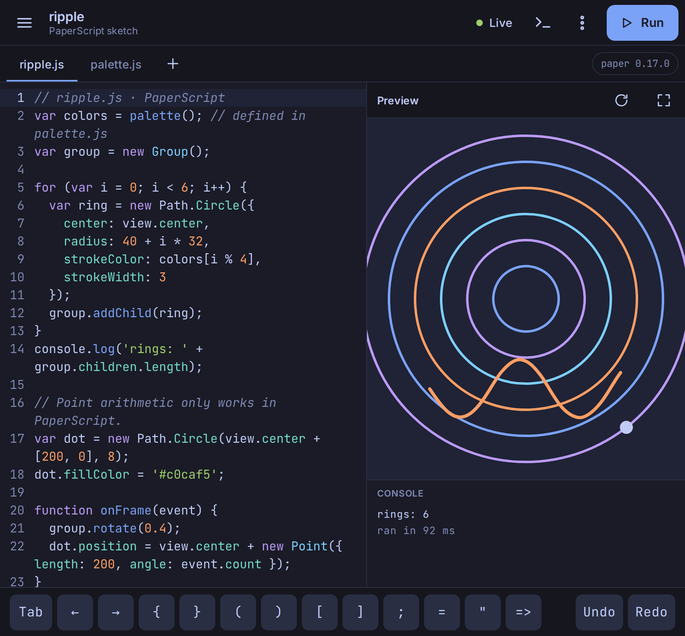
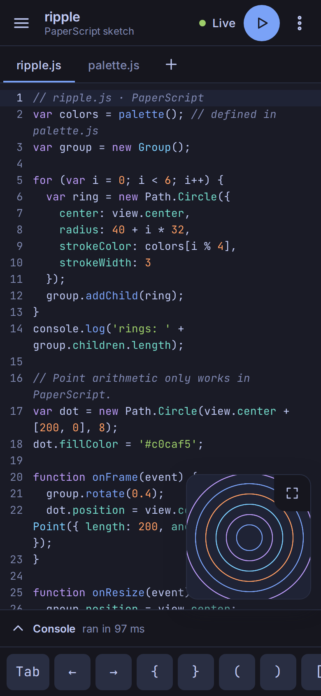
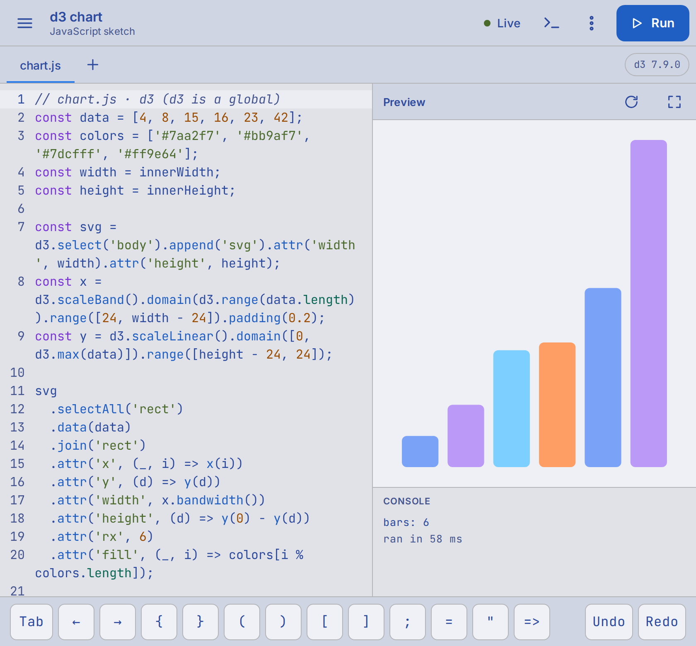

# Paper Playground

A touch-first creative-coding playground for [Paper.js](http://paperjs.org/), built as an installable web app for the Pixel Fold. Edit a sketch and see it render in under half a second, online or off.

**Open it:** https://micahcraig.github.io/paper-playground/

| Unfolded | Folded |
| --- | --- |
|  |  |



## What it does

- **Live preview.** Sketches run in a sandboxed iframe. With Live on, the preview reruns 250 ms after you stop typing. A run with an error keeps the last good render on screen, and the console shows the error with its file and line.
- **PaperScript, JavaScript or TypeScript.** PaperScript supports Paper.js point arithmetic and modern syntax. `.ts` files are stripped of types before they run.
- **Libraries.** Each project chooses from Paper.js 0.17.0, p5.js 2.3.4, Three.js 0.186.1 and d3 7.9.0. A sketch loads only its project's libraries.
- **Projects.** Projects can have several files. They run in tab order and share one scope. Projects are saved in the browser as you type and can be exported and imported as JSON.
- **Made for touch.** All buttons are at least 44 px. A symbol strip gives you the keys Gboard hides. Autocorrect is off in the editor. The layout switches at 600 px, so folding and unfolding the phone changes it.
- **Works offline.** After the first visit, the app, the libraries and the fonts (Inter and JetBrains Mono) are all cached.
- **Themes.** Tokyo Night and Tokyo Night Day follow the system setting by default. To choose one yourself, open More options and use Theme.

## Install on the Pixel Fold

1. Open the link above in Chrome.
2. Open the Chrome menu and choose **Add to Home screen**, then **Install**.
3. Launch it from the home screen. It opens without browser chrome, and it works in airplane mode from then on.

The app updates itself: after a deploy, the new version loads the next time you open it.

## Limitations

- An infinite loop in a sketch freezes the tab. Reload the app; your code is saved.
- Files can't `import` each other. Every file runs in one shared scope.
- There are no accounts and no sync. Projects live in this browser only, so export the ones you want to keep elsewhere.

## Develop

Requires Node 22 or newer.

```bash
nvm use        # if your default Node is older
npm install
npm run dev
```

## Test

```bash
npm run typecheck
npm test                         # unit tests (Vitest)
npx playwright install chromium  # first time only
npx playwright test              # end-to-end at 390×844 and 840×780
npm run screenshots              # regenerate docs/screenshots
```

### On the Pixel Fold, after each deploy

- [ ] Install from the Pages URL; launch from the home screen.
- [ ] Type in the editor with Gboard: autocorrect and composition do not corrupt code, and the caret stays visible with the keyboard open.
- [ ] Fold and unfold while a sketch runs: the layout switches and the sketch keeps its state or restarts cleanly.
- [ ] Switch the system theme between light and dark: colours match the token table in PLAN.md.
- [ ] Airplane mode: reload the app and run a saved project.
- [ ] Draw on the preview with touch: Paper.js mouse tools receive touch events.

## Deploy

Every push to `main` runs the tests and deploys `dist/` to GitHub Pages at `/paper-playground/`.
